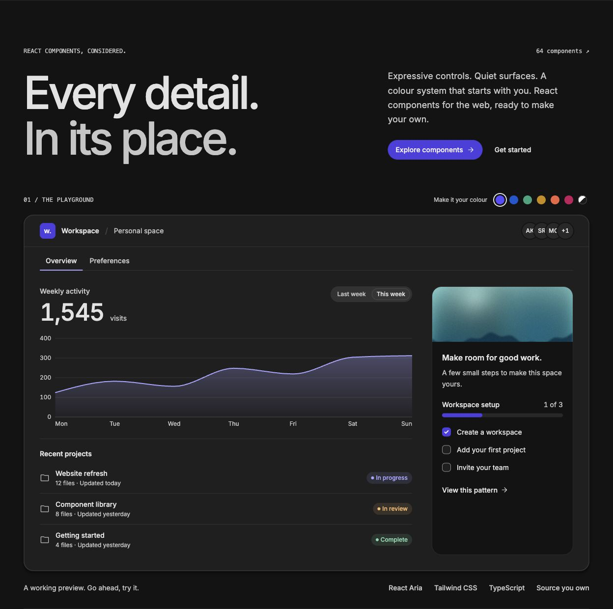
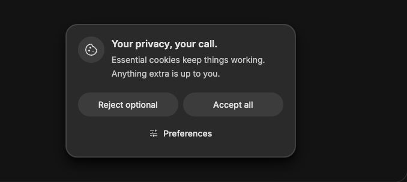
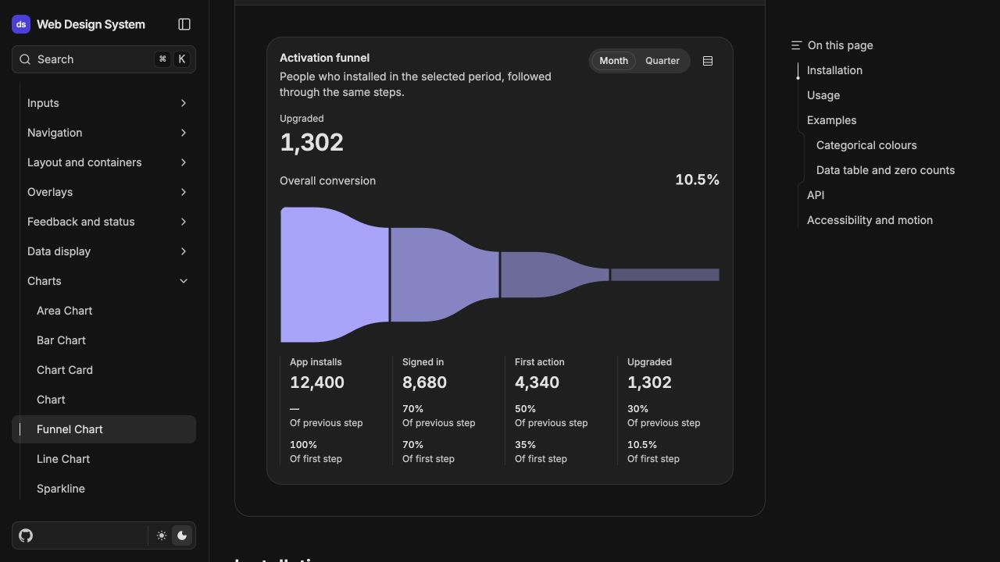

# Highwren UI

Accessible React components for marketing sites, admin panels and signed-in experiences.
Built on React Aria Components, Highwren UI combines expressive controls, calm surfaces and
semantic colours generated from one seed. Install the components you need as source through
the shadcn registry, then adapt them in your project. You own the installed copy.

[Explore components](https://ui.highwren.com/#components) ·
[Documentation](https://ui.highwren.com/docs/) ·
[Installation](https://ui.highwren.com/docs/foundations/installation/) ·
[Theme builder](https://ui.highwren.com/theme/)

[](https://ui.highwren.com/)

- React 19 and Tailwind CSS 4; framework-independent installed components.
- Light and dark themes, three contrast levels, runtime branding and right-to-left layouts.
- English defaults with typed label overrides, locale-aware dates and numbers, reduced motion.
- Forms, navigation, overlays, feedback, data tables and charts.
- Real Chromium interaction and accessibility tests, plus clean-consumer installation checks.

This is an early, pre-1.0 library; review changes before updating installed source.

## Install components in another project

Start with **React 19, TypeScript and Tailwind CSS 4**, a configured `@/*` path alias and a
`components.json` file. Next.js is optional; installation is also verified in a Vite app.

**1. Connect the registry.** Merge this entry into `components.json`, preserving your other
registries and aliases. The [installation guide](https://ui.highwren.com/docs/foundations/installation/)
includes a complete configuration.

```json
{
  "registries": {
    "@ds": "https://ui.highwren.com/r/{name}.json"
  }
}
```

**2. Install the foundation and a component.** Run this in your own project:

```bash
npx shadcn@4.23.0 add @ds/theme @ds/ds-provider @ds/button
```

**3. Apply the theme and provider.** Import the installed `styles/ds/theme.css` after Tailwind in
your global stylesheet, then wrap your app in `DSProvider`. Follow the
[setup examples](https://ui.highwren.com/docs/foundations/installation/#set-up-your-app)
for stylesheet paths and the provider wrapper.

With the guide's aliases, you can then use:

```tsx
import { Button } from '@/components/ds/button';

export function SaveAction() {
  return <Button onPress={() => console.log('Saved')}>Save</Button>;
}
```

The CLI resolves dependencies and copies the licence and notices into `licenses/ds/`.
Public installation needs no repository checkout or credentials.

### Update installed source

Installed files belong to your project and stay unchanged until you choose to update them.
Review upstream changes before replacing a customised copy:

```bash
npx shadcn@4.23.0 add @ds/button --diff
```

The public registry follows verified `production` commits. Version tags identify source snapshots;
pre-1.0 APIs may change between releases.

## Component previews

These are real catalogue examples. Select an image to open its live usage guide and API reference.

<details>
<summary>Cookie Consent — privacy choices with inline preferences</summary>

[](https://ui.highwren.com/docs/components/feedback/cookie-consent/)

</details>

<details>
<summary>Funnel Chart — activation stages, conversion rates and a data table</summary>

[](https://ui.highwren.com/docs/components/charts/funnel-chart/)

</details>

## Run the catalogue

To work on this library locally, use Node.js 24 or newer, npm and Git. With nvm, `nvm install`
selects the checked-in Node version.

```bash
git clone https://github.com/oguzhanozgokce/web-design-system.git
cd web-design-system
npm ci
npm run dev
```

Open the address printed by Next.js, normally [localhost:3000](http://localhost:3000).
No application secrets or `.env` file are required. Dependency installation and the build's
Google Fonts download need network access. See the
[local registry guide](content/docs/foundations/installation.mdx#develop-against-a-local-registry)
to try unpublished components in another project.

## Contribute

Fork the repository, create a branch from `main` and open a pull request against `main`.
The maintainer reviews changes and owns merging and publication. Start with
[CONTRIBUTING.md](CONTRIBUTING.md) for scope and review expectations, and
[docs/testing.md](docs/testing.md) for test selection.

Install Chromium for browser tests, then run the required checks:

```bash
npx playwright install --with-deps chromium
npm run generate
npm run check
npm test
npm run check:registry
npm run build
```

GitHub Actions verifies pull requests and `main` on Linux, including dependency auditing and a
full-history secret scan. The maintainer promotes reviewed work from `main` to `production`;
successful production checks deploy the same build output to Hostinger. See
[publication controls](docs/open-source-readiness.md) and [registry hosting](docs/registry-hosting.md).
Report vulnerabilities through [SECURITY.md](SECURITY.md).

## Repository layout

| Location                     | Purpose                                           |
| ---------------------------- | ------------------------------------------------- |
| `registry/ds/`               | Installable source and catalogue-only `examples/` |
| `registry/items/`            | Registry metadata and third-party credits         |
| `content/docs/`              | Installation, component APIs and examples         |
| `tokens/config.json`         | Seed colour and palette configuration             |
| `docs/research/web-style.md` | Current visual specification                      |
| `AGENTS.md`                  | Repository contracts and verification             |
| `ROADMAP.md`                 | Delivery status and planned work                  |

## Licence

[Apache-2.0](LICENSE), with project attribution in [NOTICE](NOTICE) and adapted-source attribution
in [THIRD_PARTY_NOTICES.md](THIRD_PARTY_NOTICES.md). Every registry installation also copies the
licence and combined notices to `licenses/ds/` in the consumer project. Preserve those notices
when redistributing source, and identify changes to adapted Apache-licensed files.

The four `public/samples/*.jpg` images are original procedural artwork generated by
[`scripts/generate-samples.ts`](scripts/generate-samples.ts) and covered by the project licence.
They contain no stock photography or external image assets. Regenerate them with
`npx tsx scripts/generate-samples.ts` after installing Playwright Chromium.
